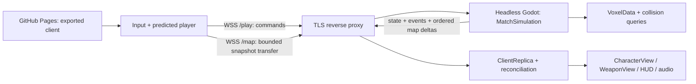

# Iteration 2 multiplayer implementation plan

> Historical pre-removal design/evidence. Multiplayer was withdrawn on2026-10-12
> under [ADR0031](decisions/0031-offline-only-game.md). Deleted networking paths
> and server instructions below do not apply to the current offline game.

Original design prepared on2026-10-10 against Godot **4.7.2** and OpenSpades v0.1.3 `dcf449c845d509bbde9d79239b32d201c1389961`. Production networking has since been implemented: N01–N08 are `IMPLEMENTED`, N09 is `VERIFIED`. This page retains design goals and acceptance scenarios; current contracts are [network-protocol.md](network-protocol.md), [server-runtime.md](server-runtime.md), [client-replica.md](client-replica.md) and [network-session.md](network-session.md). Current evidence and ownership live in [status.md](status.md) and [parity.md](parity.md). Neither iteration has passed full acceptance.

## Target deployment and transport

Keep the exported Godot client on `https://gordey328.github.io/Blockfield/`. Run the simulation on a separate host, with a valid domain/TLS certificate and a reverse proxy exposing `wss://<game-domain>/play` and `/map`. Pages only hosts static files; it cannot run the authoritative process. [GitHub Pages documentation](https://docs.github.com/en/pages/getting-started-with-github-pages/what-is-github-pages)

Use the same pinned Godot release for the browser and a Linux dedicated-server export. Start the server through the `dedicated_server` feature or an explicit `--server` user argument, not merely because the display driver is headless: our existing offline tests are also headless. A server scene must not instantiate main's camera, HUD, audio, model loaders or post effects. Godot supports headless export-template execution and removal/stripping of presentation resources. [Dedicated-server export](https://docs.godotengine.org/en/4.7/tutorials/export/exporting_for_dedicated_servers.html)

Proposed initial transport: `WebSocketPeer`, an explicit binary protocol, and `TCPServer` on the native server behind TLS termination. Poll both connection states and packets every frame; wait for `STATE_OPEN` before HELLO and continue polling during clean close. Bind the native listener to loopback when a same-host proxy is used. Browser clients use hostname-matched WSS. Do not depend on custom browser handshake headers or WebSocket ping control frames: Godot documents both as unavailable in Web exports. Use an application HELLO and PING/PONG. [WebSocketPeer API](https://docs.godotengine.org/en/4.7/classes/class_websocketpeer.html)

`WebSocketMultiplayerPeer` is a supported alternative, including native `create_server` and WSS `create_client`, but scene RPC replication is unnecessary for this design. An explicit codec makes command validation, offline tests and map barriers independent of scene paths. [WebSocketMultiplayerPeer API](https://docs.godotengine.org/en/4.7/classes/class_websocketmultiplayerpeer.html) Godot RPC otherwise requires matching node paths/signatures on both sides. [High-level multiplayer](https://docs.godotengine.org/en/4.7/tutorials/networking/high_level_multiplayer.html)

WSS is reliable and ordered **TCP**, with head-of-line blocking under loss. Calling a packet/RPC “unreliable” cannot create UDP semantics over that connection. A separate bulk connection prevents map bytes queued on one socket from sitting ahead of gameplay on that same socket; it does not eliminate shared-link congestion or TCP stalls. Bound queues and measure this before accepting the FPS experience. Godot explicitly identifies this latency limitation and provides WebRTC as another browser option. A switch to WebRTC data channels would be a later measured transport decision requiring signaling/native-extension/hosting work, not a silently interchangeable setting. [Godot WebSocket guidance](https://docs.godotengine.org/en/4.7/tutorials/networking/websocket.html)

The hostname, server provider, credentials and process supervisor are deployment inputs still to be selected. This preparation creates no account, server, certificate or service. Client configuration contains only a public WSS endpoint and protocol/build identifiers; no administrator key belongs in the Pages bundle.

## Shared simulation and module contracts

Extract rules before attaching a socket to `LocalSession`. Keep the offline lab working through the same command interface.

| Proposed module | Responsibility / contract |
| --- | --- |
| `game/simulation/player_state.gd` | Typed state for every actor: stable `player_id`, `spawn_generation`, connection status, name/team, motion, aim, weapon/tool, resources, cooldown/reload/cook deadlines, tool readiness, kills/deaths and respawn state. No “local player” rule in this object. |
| `game/simulation/match_simulation.gd` | `step_fixed(tick, inputs)`, `submit_action(player_id, action)`, `get_player(id)`, `snapshot_for(id)`. Own all actor/grenade/objective/map mutations and emit immutable typed events. Server and local adapter use this same implementation. |
| `game/simulation/player_rules.gd` | Input-to-velocity acceleration, gravity/friction, source crouch/step/landing, tool readiness and source shot/recoil/cadence rules. No `Input`, camera, `WeaponView`, audio, `randf()` global stream or render-frame dependency. |
| `game/world/voxel_data.gd` | Packed color/solid cells, dimensions, clip/ray queries, ordered edit/collapse transactions. Presentation wrapper `VoxelWorld` still owns meshes, water, top-down textures and falling visual clusters. A server never needs chunk meshes or Godot physics bodies to answer a source motion sample. |
| `game/network/protocol.gd` / `ws_transport.gd` | Versioned bounded codec and socket lifecycle. Deliver decoded commands/state, not arbitrary node/property changes or UI callbacks. A fake transport exercises the same interface. |
| `game/network/server_runtime.gd` | Connections, sender-to-player binding, tick scheduler, admission/timeouts, command validation, history, snapshots and match configuration. |
| `game/network/client_replica.gd` | Confirmed match state, command history, prediction/reconciliation, remote interpolation, map barriers and event deduplication. Expose a read-only session view plus command submission to HUD/controller. |
| `LocalSession` adapter | Offline actor selection and lab permissions; retain current user-facing methods while delegating rules to `MatchSimulation`. Live matches reject lab-only resource/pose/spawn/profile/reset actions unless a server explicitly runs a lab policy. |

The existing `SourcePlayerMotion` already isolates clip/step/uncrouch and exposes a copyable `State`. Retain its float32 goldens, Godot axes and native velocity magnitude (`displacement = native_velocity * 32 * dt`). Its current `VoxelWorld` type annotation must be narrowed to a shared voxel-query/data type; creating a hidden renderer on the server is not the separation. Acceleration, held jump, sprint's previous-speed threshold, fall damage and tool readiness currently remain in the controller and must move into rules.

### Concrete local assumptions to remove

Line numbers below refer to the reviewed workspace; method names remain the useful anchors after refactoring.

| Current assumption | Evidence | Required change |
| --- | --- | --- |
| One privileged scalar player, separate reduced target dictionaries | `local_session.gd:65–104`, `add_target:467`, `damage_player:336`, `apply_target_damage:520` | One actor registry for local/remote/dummy actors; actor-specific resources and attribution. `local_player_id` is a client-view preference only. |
| Intel carrier hardcoded to `0` | `_update_ctf:635–670`, `_drop_carried_intel:673` | Stable actor ID, `-1` for no carrier; drop/capture/return/resupply checks for every eligible actor in deterministic ID order. |
| TC separately counts local player and targets | `_update_tc:683–735` | Count the actor registry once; omit dead/spectator/disconnected actors according to the server policy. |
| All target kills belong to the local shooter/current weapon | `apply_target_damage:538–539` | Explicit attacker ID, weapon/action ID and damage cause; grenade damage retains the thrower's ID after death/disconnect. |
| Weapon selection refills stock; profile changes are player-accessible | `select_weapon:147–158`, `set_profile_version:140` | Separate offline lab refill from server-approved class selection. Match profile is negotiated from the server; class/respawn transitions have explicit rules and acknowledgments. |
| Timers tick in render frames | `main.gd:124`, `LocalSession.update:260` | Fixed 60 Hz simulation clock/deadlines; no independent per-client countdown authority. Existing variable-delta tests remain compatibility tests during extraction. |
| Movement/tool authority depends on `Input` and a view's lower/raise state | `player_controller.gd:181–261`, `can_use_tool:272–280`, `_sprint_state:769` | Commands feed pure rules; simulation owns lower/raise/sprint readiness. Animation consumes normalized state but cannot authorize a shot. |
| Shooting/spread/block health mutate the world from the local controller | `_shoot`, `_block_health`, `_damage_block` | Server-owned persistent damage; automatic source recovery removed by user request (ADR0010); isolated shot RNG unaffected by footstep/corpse/particle randomness. |
| Grenade motion and damage live in a visual node | `lab_grenade.gd:33–95`, `LocalSession.release_grenade:418–436`, `set_grenade_position:451` | Pure grenade state/step/detonation on the server. A client visual never supplies authoritative position or calls explosion damage. |
| Presentation reads/mutates target dictionaries directly and local death uses ID0 | `main.gd:185,787`, `lab_hud.gd:386–393,1159`, controller `raycast_targets:557` | Replica read-only actor views, commands for actions, per-actor spawn generations; effects/scoreboard/map/follow use stable IDs. Keep authored pose previews in offline lab only. |

Offline `LOCAL_*` objective/respawn/melee policies are authored because the upstream repository is a client. Reuse them initially as an explicitly versioned **server ruleset**, not as proof of original AoS server behavior. Record any later policy change in an ADR and regression tests.

## Clock, protocol and authority

Proposed first baseline: 60 Hz simulation, 20 Hz actor snapshots, full snapshots before any delta compression. These are tuning targets, not measured capacity claims. Connection identity and actor ID are different; reconnect can change the former while retaining the latter. Do not assume network peer `1` is an actor or actor `0` is the client.

The binary envelope carries protocol version, message kind, payload length, `match_epoch`, tick and sequence IDs. Document endianness, float32 encoding and limits in a protocol reference when implemented. Message families:

- HELLO/WELCOME/REJECT: build/rules hashes, role, name, assigned actor, server clock and resumable session token. Unknown/incompatible versions fail before map allocation.
- INPUT_BATCH: bounded fixed-step records with input sequence, mapped tick, yaw/pitch, movement/button bits and selection intents. No client position, damage, stock, velocity, capture or kill result is authoritative.
- ACTION_RESULT / GAME_EVENT: accepted/rejected action ID, server tick and optional shot/grenade/map transaction linkage. Every effect-bearing event has a stable ID.
- SNAPSHOT: server tick, consumed input sequence, actor states, confirmed resources/deadlines/objectives, map sequence and event cursor. Owner-private ammo/state is distinct from remote public pose.
- MAP_BEGIN/CHUNK/END/DELTA/READY: snapshot identifier/hash/size, ordered transactions and join barrier.
- CHAT, PING/PONG and CLOSE/RESYNC: bounded application messages. Authenticate the sender from the connection; a supplied actor ID cannot impersonate another player.

Validate lengths/counts before allocation, finite floats, pitch range, enums, cell bounds and bounded UTF-8 text. Initial proposed caps: ordinary frame 32 KiB, bulk chunk 16 KiB, input batch 8 records, match map at most 512×64×512 cells, uncompressed color snapshot at most 64 MiB. Check declared decompressed size and hash before loading. Check current outbound buffered bytes, prioritize events/input/state, retain only unsent newest replaceable snapshots, and disconnect/resync a persistently slow peer rather than growing memory. Already queued TCP bytes cannot be withdrawn.

The native runtime consumes at most one movement step per actor per server tick. It never trusts a client-provided `delta`, executes multiple queued movement steps to grant extra speed, or ages a cooldown from wall-clock input timestamps. Negotiate a bounded input lead; accept small batches for low rendering FPS, repeat missing movement briefly without inventing new button edges, and rebase when stale/future/backlogged inputs exceed the configured window. Action sequences prevent a quick cook/release or class transition being executed twice. Time-sync samples bound the tick mapping; client timestamps are hints, not permission for arbitrary rewind.

## Prediction, reconciliation and remote views

1. Capture commands at the fixed client simulation rate, independent of render FPS. Predict only the owning live actor using the shared rules and current confirmed voxel data. Retain state/commands in a bounded history with action IDs.
2. A snapshot acknowledges consumed commands. Restore authoritative motion **and** resources/reload/cook/readiness, apply the appropriate confirmed map sequence, then replay later commands using fixed dt. Capture the pre-reconcile visual pose and decay its correction separately; collision and aim immediately use the corrected state.
3. Replay emits no real damage, chat, sounds, duplicate grenade, collapse or HUD feed. Effects use predicted IDs then confirm/reject once. Death, respawn generation, map reset, team/class changes and reconnect clear incompatible prediction history.
4. Keep unconfirmed building as preview/ghost geometry initially, without collision or authoritative voxel mutation. This avoids phantom floors during reconciliation. A later predicted-block collision policy requires separate tests.
5. Use server-owned RNG for cumulative shotgun spread. Predict source recoil/tool animation and resource use; confirm hit indicators, pellet impacts and damage from the server. Do not accept a chosen client seed or client hit victim. An injectable deterministic RNG in tests must not share the cosmetic global stream.

Remote actors render from a server-timestamped buffer, initially 100 ms behind estimated server time with a bounded jitter adjustment. Interpolate feet and shortest-path yaw/pitch; retain discrete crouch/tool/team/death transitions and interpolate their visual poses. Extrapolate at most 100 ms, then freeze/show poor-connection status. Clear buffers on spawn generation or epoch change; never interpolate a corpse into a new spawn. Server collision/hit history uses simulation states, not interpolated visual nodes.

Browser tabs can suspend processing, so returning to a tab needs a fresh state and possibly rejoin rather than replaying a minutes-long input queue. Cursor capture/fullscreen/audio still need gesture callbacks; connection callbacks cannot silently capture input. [Godot Web export limitations](https://docs.godotengine.org/en/4.7/tutorials/export/exporting_for_web.html)

## Shooting, lag compensation and destructive terrain

Authoritative shots validate actor alive/team, selected tool, source lower/raise/sprint gates, ammo/reload state, cadence, action ID, finite aim and rules profile. Compute muzzle/physics-eye origin, source accumulated spread, ordered `LabHitVolumes` intersections, horizontal-distance hit selection and the 128-unit limit on the server. Preserve source head-first volume priority and crouch/pitch geometry. Return accepted shot/pellet results for presentation and authoritative resource state.

Keep roughly 250 ms of timestamped actor pose/spawn-generation history as an initial configurable rewind bound. Derive the permitted shot time from synchronized input/view time; clamp against receive tick and per-connection delay. Rewind only the query, not live actor nodes or the whole match. Ignore actors that belonged to another spawn generation. Cadence and ammo remain current server gates even when the ray is evaluated in history. Projectiles, respawn/objective capture and building do not receive arbitrary rewind.

Voxel occlusion must also match the rewind time: retained map transactions supply a read-only historical voxel query, using changed-cell overlays or per-chunk history, for the same shot tick. Use the same historical target/map comparison; a newly built wall and a recently destroyed wall require explicit tests. If history has expired or was truncated after a large collapse, reject unavailable rewind/use a documented current-time rule and report it; never silently shoot through current terrain by rewinding only players. A provisional first multiplayer slice may use current-time hit validation, but N03 remains incomplete until tested lag compensation exists.

Server-authorize spade reach/cadence, block stock/reach/support/actor overlap, drag-line ordering/depletion, pending mid-air placement and grenade cook/release/fuse/bounce/damage. The server emits the complete ordered edit transaction including collapse removals; clients do not independently decide which unsupported voxels vanish. Visual falling clusters/corpses are presentation and cannot damage players or alter collision unless a later explicit rule adds that behavior.

## Joining and map order

Each reset/map change starts a new `match_epoch`; map transactions have monotonic `map_seq` within it. At server tick T0, obtain an immutable/copy-on-write voxel baseline at S0, its hash/dimensions and associated persistent damage mask. Capture match/actor/grenade/objective state with tick/map-sequence references. Serialize/compress the frozen data incrementally outside the critical tick; do not block a live match on `VoxelWorld` meshes or a complete render-world VXL export.

The join state machine is `CONNECTING → NEGOTIATING → LOADING_MAP → CATCHING_UP → READY → PLAYING`, with explicit error/retry/cancel exits. The bulk socket is bound to the existing session through a short-lived server-issued token. It cannot create a second player. Gameplay deltas after S0 are journaled while chunks transfer; a new client buffers them without mutating a partial world. Proposed retained join-delta bound is 8 MiB; overflow restarts from a newer baseline, then fails visibly if retry cannot catch up.

After checking the baseline hash, apply all complete transactions S0+1 through a server-specified T1 barrier, then install the actor/objective/grenade snapshot that references that exact map sequence. READY acknowledges the barrier/hash; only then may the server spawn a playing actor and accept commands. Order matters across the two sockets: the gameplay snapshot cannot be used before its referenced map changes exist. Missing sequence, before-color mismatch or epoch mismatch requests resync rather than applying a guessed edit. Store each transaction's actor/action/tick, before/after colors and collapse linkage. VXL remains import/export interchange; it alone does not carry match epoch, actor state or block-damage timers.

## Match services and reconnect

- **CTF/TC:** all living actors participate through one registry. Serialize flags/carrier IDs, territory owner/capturing team/progress/contested state, team metadata/score, win state and rules version. Resolve simultaneous pickup/return/capture deterministically. Team switch, death, timeout and disconnect drop intel exactly once; reset clears old projectiles, timers, history and deferred actions.
- **Respawn/class/spectator:** server chooses spawn positions/time, restock and approved weapon/team transitions. Publish spawn generation and event. Spectators have no physical combat actor and cannot shoot/build/capture; teammate-follow permissions are derived from server roster/life/team state.
- **Chat/scoreboard/events:** global/team channels are server-routed with bounded text/rate/history. Server assigns author/name/team/event ID; HUD displays confirmed state and does not echo twice after an acknowledgment. Keep the typed console local; multiplayer `/team` or `/mode` becomes an authorized request/rejection, not a client state mutation. Do not relay script/config commands.
- **Discovery (N07):** provide a versioned server catalog, sorting/filtering, latency/capacity/status and local favorites, plus direct WSS entry. A static Pages JSON catalog can list our new endpoints; a server handshake supplies fresh room/match metadata. Original AoS master-list entries are incompatible and must not appear joinable. The catalog is an explicitly documented replacement, not a claim of compatibility with old servers.
- **Reconnect:** application heartbeat initially every 2 s; stale connection enters disconnect handling after a configurable 10 s. Clear held buttons after a short input timeout. Drop intel and remove the actor from objectives/collision promptly, retain roster score/name for a bounded reconnect grace, and reconnect as a fresh spawn/spectator according to the ruleset. A resumable random token restores identity, not unconfirmed commands or invulnerability. Replace old connection bindings, rotate tokens, prohibit simultaneous ownership and do a new map/state barrier. Token stays out of URLs/logs; expiry or server restart gives a clear fresh-join path.

## Work slices and acceptance

| Slice | Concrete deliverable | Gate / parity rows |
| --- | --- | --- |
| 1. Shared rules extraction | Actor registry, pure motion/tools/grenades/voxel data, offline adapter; same public offline behavior | Existing source-motion 128, session109 and source-parity151 remain passing; new two-actor authority cases. N02/N03/N05 still incomplete. |
| 2. Protocol + native loopback | Codec, fake transport, headless server entry/config, two real native clients, connection/session state | Reject malformed/oversized/nonfinite/impersonating commands; fixed tick and per-player resource independence. N01/N08 partial implementation. |
| 3. Browser join + replication | WSS handshake, version errors, two exported browser clients, baseline/deltas, interpolation | Both browsers see identical map hash/state after mid-round join; TLS/Origin/proxy and background-tab behavior proven. N01/N02/N04. |
| 4. Full combat + prediction | Reconciliation, shot events, source tools, server grenade rules, voxel/player rewind | Cadence/ammo/reload/depletion, replay deduplication, source hit-zone and terrain-history tests at latency. N02/N03/N04. |
| 5. Match/UI services | CTF/TC/team/class/respawn/follow/chat/catalog/favorites/reconnect | Simultaneous captures/team chat privacy/reset and reconnect generations on two clients; N05/N06/N07. |
| 6. Hosting/release | Pinned Linux server artifact, configuration/process health/logging, public TLS endpoint, Pages client | Independent clean server start; exact build/protocol/rules hashes; sustained capacity/latency/browser test report; N08/N09 and iteration-2 acceptance. |

Meaningful new suites under `tests/network/` should cover:

1. Shared deterministic command traces on server and predicted client: ground/wade/step/uncrouch/fall, low render FPS, held jump, tool gates and profile-specific cadence. Different cosmetic RNG calls must not alter shot outcomes.
2. Two actors firing/reloading/cooking independently; ownership spoof, duplicate action, future tick, stale queue, dead/spectator input, class refill exploit and one grenade per forced/death release.
3. Reconcile after rejected placement, received damage, late map edit, respawn and team switch; commands replay without repeated audio/effects/chat/resources. Spawn generation clears old hit/follow/interpolation state.
4. Rewound standing/crouched head/leg hits, strict volume/map ties and horizontal range; new/destroyed walls, history exhaustion and packet-time clamp. Current server cadence still blocks timestamp manipulation.
5. Ordered map snapshot while shots/lines/grenades/collapse modify the world; disconnect on every transfer stage, corrupt/truncated/oversized chunks, delta overflow/resync and round reset during catch-up. Baseline plus deltas must hash exactly like the server.
6. CTF pickup/drop/return/capture/resupply and TC opposing/multiple players, reset while grenades/reloads are pending, reconnect both with valid token and expired/stolen/wrong-session token, team chat recipient isolation and bounded logs.
7. Real socket/TLS smoke tests and exported-browser interaction; fake message loss is not a TCP-loss test. Add real network impairment during acceptance: 0/100/250 ms RTT, jitter and retransmission stalls, bulk join concurrent with combat, slow clients and tab suspension. Record snapshot age, corrections, RTT, server tick time, queue bytes and map-join time.

Start gameplay acceptance with two clients; capacity testing then grows to a proposed initial 32-player configured room on Title.vxl. Measure sustained fixed-tick cost, bandwidth/memory and stalled-peer isolation rather than inferring capacity from a two-client pass. Numeric quality thresholds and hardware are recorded before the load run; passing fake transport or native headless tests does not prove browser network/input/audio quality.

The existing pinned local validation path remains usable while GitHub Actions is externally blocked. Server packaging/deployment must be reproducible separately from static Pages publication; no background runtime can be smuggled into the `gh-pages` branch. AoS ENet 0.75/0.76 wire compatibility is intentionally outside the authorized replacement transport; retain source weapon profiles while clearly labeling new server compatibility (N09).

## Context and next action

Use `.agents/skills/blockfield-multiplayer/SKILL.md` for future networking work; this plan holds the proposed design, `docs/parity.md` holds N-row evidence and `docs/status.md` holds active ownership/last verified checkpoint. Before implementation, convert accepted transport/rules/identity choices into a numbered ADR and write the actual protocol schema with byte layout/limits. Avoid copying this mutable design into several skills or into chat-only notes.

The initial implementation split was rules/actor state, voxel/map barriers and protocol/prediction, with integration owned by the coordinator. Those production handoffs are complete. Use the current ownership section in status.md before changing files; do not infer an active lease from this historical plan. The user chose Docker/configuration preparation while keeping host/domain selection open. Public TLS/WSS deployment remains a separate unverified acceptance boundary.
